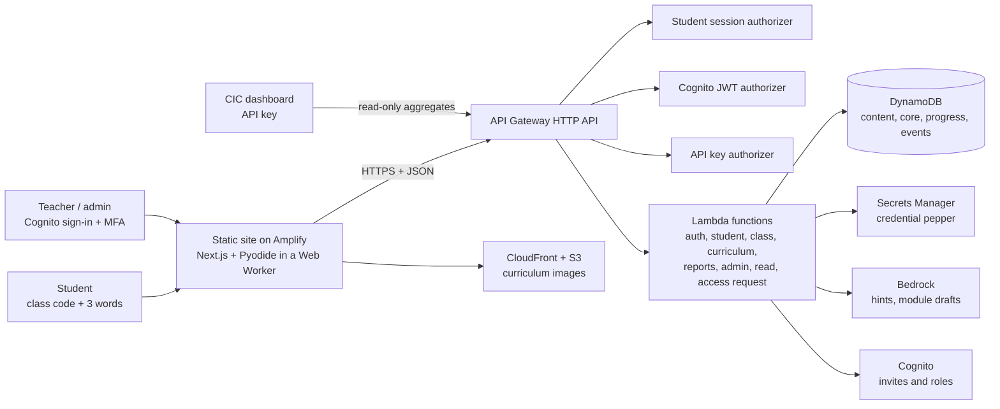

# CIC Learn: a curriculum and student progress platform for Coding in Color

Built by **Code Titans** at the [ASU Fall Hackathon 2026, Phoenix Hackathon for Nonprofits](https://www.ohack.dev/hack/fall-2026) (Nov 14-15) for the public good. MIT license.

**Live site:** https://main.d3voqx7r17ipz6.amplifyapp.com (students open `/s`, staff sign in at `/login`)

[Coding in Color](https://www.ohack.dev/nonprofit/YIXYdYCoxIZC08uQ5DL3) (CIC) teaches computer science to students across Arizona. CIC Learn lets a teacher put a class on CIC's curriculum in minutes, lets each student work through lessons at their own pace without an account, and shows teachers and CIC what was actually learned.

| | |
|---|---|
| Nonprofit | [Coding in Color](https://www.ohack.dev/nonprofit/YIXYdYCoxIZC08uQ5DL3) |
| Problem statement | [Curriculum & Student Progress Platform (CIC Problem 1)](https://www.ohack.dev/project/d09466fadf1b11f18e63deadc507a848) |
| Team | [Code Titans](https://www.ohack.dev/hack/fall-2026/team/b392ef8ce05f11f18371deadfb009123) |
| Demo video | [Watch on YouTube](https://www.youtube.com/watch?v=4pJpQ0gu-5wEk) |

## Contents
[What it does](#what-it-does) · [Using the app](#using-the-app) · [What we built against the brief](#what-we-built-against-the-brief) · [Tech stack](#tech-stack) · [Architecture](#architecture) · [Repository layout](#repository-layout) · [Run it locally](#run-it-locally) · [Configuration](#configuration) · [Deploy](#deploy) · [Security](#security-and-privacy) · [Accessibility](#accessibility) · [Testing](#testing-and-quality) · [Documentation index](#documentation-index) · [Limitations](#known-limitations) · [Team](#team)

## What it does

**For students.** No email, no password. A teacher prints a login sheet; a student opens their link, or types the class code and three secret words. Each lesson is a short path of steps: pretest, video or slides, checks, worksheets, **coding exercises** and a post-test. Students who join late land on the module their class is on and can catch up on earlier ones. A student who is stuck can ask an **AI hint** that nudges without giving the answer, and there is a free **Code runner** for practice.

**For teachers.** Upload the class list from a spreadsheet, pick modules, print the login sheets. The dashboard shows who is stuck or has not started, per-student progress, **learning gain** from pretest to post-test, and **mastery per concept** ("33% of the class reached 80% on loops"). Worksheets that need a human go to a review queue. A **hints report** shows what students asked the AI tutor about, so you know what to reteach, and a **gradebook** (downloadable as CSV) lists every student's scores, gain and hints. Duplicate roster entries are flagged and can be merged.

**For CIC.** Admins invite staff, manage schools and cohorts, and author and publish curriculum (instructors can be made "curriculum authors"). An author can upload a printed worksheet or slide deck and have the AI **draft a module** from it, which they then review and edit before publishing. A read-only **API with keys** feeds CIC's own dashboard with aggregated results only. Teachers outside CIC can **request an account**; an admin approves, and they run their own classes on CIC's curriculum. CIC sees usage counts for those classes and nothing about their students.

### Who can do what

| Role | How they sign in | Can |
|---|---|---|
| Student | Class code + 3 secret words | Do their own lessons, ask for hints, use the Code runner |
| Instructor (CIC) | Cognito, MFA | Run their classes, see their students' progress. Browse and assign published modules |
| Curriculum author | Instructor with an admin-set flag | Also create, edit and publish any module |
| CIC admin | Cognito, MFA | Everything on CIC's side: users, schools, cohorts, API keys, audit log, access requests, usage |
| External teacher | Cognito, MFA, after admin approval | Run their own classes. CIC cannot see their students |
| Reviewer | Cognito, MFA | Preview published curriculum only. No class or student data |
| CIC dashboard (machine) | API key | Read aggregated cohort results |

## Using the app

Nothing needs a manual. These are the first steps for each kind of user.

- **A student** opens the link on their login sheet, or goes to the site, presses **Open my lesson**, and types the class code and three words. They land on **Your learning path**, press the highlighted step, and each step unlocks the next. On a check, worksheet or coding exercise, **Ask for a hint** gives a nudge. **Code runner** in the menu is a free practice space.
- **A teacher** signs in at `/login` with the email and temporary password from the invite, then sets a new password and an authenticator app. **Classes** has the **New class** button. In the class, **Add students from a CSV**, choose modules under **Assigned modules**, and print the **Login sheet**. **Progress** shows who is stuck or has not started.
- **A curriculum author** (an instructor an admin has allowed to author, or an admin) opens **Curriculum**. **New module** starts from a template. **Draft from a file (AI)** builds a first draft from a worksheet or deck. Edit, then **Save draft** and **Publish**.
- **A CIC admin** invites people under **Users**, approves outside teachers under **Access requests**, and creates keys for CIC's dashboard under **API keys**. The first admin is created from the command line ([operations.md](docs/operations.md#create-the-first-admin)).

## What we built against the brief

The brief had three tiers. **All nine P0 items are built**, **all five P1 items are built** (only one was required), and **three of the five P2 moonshots are covered, two of them in part**. Every screenshot below is a real screen of this app. The two public pages are the live site.

<table>
<tr>
<td valign="top"><br><sub>The live home page. Students open their lesson; teachers sign in.</sub></td>
</tr>
</table>

### P0: must demo Sunday

#### 1. Easy way to create and edit curriculum

Instructors and CIC staff build modules in a visual editor and publish them with no engineering. Steps collapse into a short list with an outline and the toolbar stays in view. **Draft from a file (AI)** turns an uploaded worksheet or slide deck (PDF or PowerPoint) into a full draft module, with a pretest, post-test, check questions and worksheet prompts, which the author edits before publishing. Each publish makes a new version. The publisher's own classes move to it, and other teachers' classes stay on the version they have until their teacher moves them.

<table>
<tr>
<td width="50%" valign="top"><br><sub>The module editor</sub></td>
<td width="50%" valign="top"><br><sub>Authoring a coding exercise: instructions, starter code, a private solution and tests</sub></td>
</tr>
</table>

**Draft from a file (AI), step by step.** The screenshots below are from a real run of the live app with a 1.3 MB lecture PDF. The draft took about 25 seconds.

<table>
<tr>
<td width="50%" valign="top"><br><sub>1. The author chooses a PDF or PowerPoint</sub></td>
<td width="50%" valign="top"><br><sub>2. The AI drafts it in the background, and the author can hide the dialog</sub></td>
</tr>
<tr>
<td width="50%" valign="top"><br><sub>3. The draft opens in the editor. Nothing is visible to students until the author publishes</sub></td>
<td width="50%" valign="top"><br><sub>4. Pretest questions with choices and the marked answer, ready to edit</sub></td>
</tr>
<tr>
<td colspan="2" valign="top"><br><sub>5. Worksheet prompts taken from the file. A teacher scores written answers</sub></td>
</tr>
</table>

#### 2. Four roles with role-based access

Student, instructor, CIC admin and external reviewer (read-only access to the curriculum). Roles are checked on the server for every request, not just hidden in the interface. There is also a curriculum-author permission and an external-teacher role (see P1).

<table>
<tr>
<td width="33%" valign="top"><br><sub>Instructor: their own classes</sub></td>
<td width="33%" valign="top"><br><sub>CIC admin: invite staff and set roles</sub></td>
<td width="33%" valign="top"><br><sub>Reviewer: browse the curriculum, no class or student data</sub></td>
</tr>
</table>

#### 3. Content model: module, lesson, activity, in sequence

A new module starts from a template (pretest, video or slides, check for understanding, worksheet, exit question, post-test). Steps unlock one at a time, and a module unlocks when the one before it is complete.

<table>
<tr>
<td width="50%" valign="top"><br><sub>The student's path: later modules stay locked until the earlier one is done</sub></td>
<td width="50%" valign="top"><br><sub>Inside a module: the step trail, with later steps locked</sub></td>
</tr>
</table>

#### 4. Digital worksheets

Each printed worksheet becomes an activity the student completes and submits (an author can start from the printed file with **Draft from a file (AI)**). Answers save as they type. Written answers that a computer cannot mark go to the teacher's review queue.

<table>
<tr>
<td width="50%" valign="top"><br><sub>The student's worksheet, saving as they type</sub></td>
<td width="50%" valign="top"><br><sub>The teacher scores written answers</sub></td>
</tr>
</table>

#### 5. Pretest and post-test pairs, with learning gain

Each module has a paired pretest and post-test. Gain is shown per student and for the class, and per concept.

<table>
<tr>
<td valign="top"><br><sub>Learning gain for a module: average before and after, per concept, per student</sub></td>
</tr>
</table>

#### 6. Progress tracking and late joiners

Per-activity completion, scores and time on task. A student who joins late lands on the module the class is on, with the earlier ones optional.

<table>
<tr>
<td width="50%" valign="top"><br><sub>A late joiner is told where the class is and starts there</sub></td>
<td width="50%" valign="top"><br><sub>Per-step state, attempts, score and time for one student</sub></td>
</tr>
</table>

#### 7. Instructor dashboard

Roster, per-student progress, and lists of who is stuck and who has not started.

<table>
<tr>
<td width="50%" valign="top"><br><sub>The class: roster and tools</sub></td>
<td width="50%" valign="top"><br><sub>Progress: stuck and not-started lists, every student's place</sub></td>
</tr>
</table>

#### 8. Roster CSV import

Upload a class list. Only the name is required, and anything else in the file, such as birthdates, is dropped in the browser and never uploaded. A preview shows what will happen before anything is saved.

<table>
<tr>
<td valign="top"><br><sub>Check before importing</sub></td>
</tr>
</table>

#### 9. Read API, key-authenticated

CIC's own dashboard reads progress and assessment data, already aggregated, with an API key. Keys are created by an admin, shown once, stored only as a hash, and can be revoked. Groups with fewer than 5 students are suppressed.

<table>
<tr>
<td valign="top"><br><sub>Admin: create and revoke API keys</sub></td>
</tr>
</table>

```bash
curl -H "x-api-key: <your key>" https://<api-url>/v1/read/cohorts      # endpoints are listed in docs/api.md, section 7
```

### P1: pick at least one (we built all five)

#### External teacher self-serve

A teacher outside CIC requests an account. An admin approves, and the teacher creates a class on CIC's curriculum with their own roster. CIC sees usage counts for those classes and cannot see their students.

<table>
<tr>
<td width="25%" valign="top"><br><sub>The public request form</sub></td>
<td width="25%" valign="top"><br><sub>Admin: approve or deny</sub></td>
<td width="25%" valign="top"><br><sub>The external teacher's own classes</sub></td>
<td width="25%" valign="top"><br><sub>CIC sees usage only: counts and dates</sub></td>
</tr>
</table>

#### Code runner with auto-grading and instant feedback

Students write Python in the lesson and press Check my code. Each test shows pass or fail, with what was expected and what the code gave, and the score is kept for the teacher.

<table>
<tr>
<td width="50%" valign="top"><br><sub>First try: tests fail, with feedback</sub></td>
<td width="50%" valign="top"><br><sub>All tests passing</sub></td>
</tr>
</table>

#### AI tutor hints

A Socratic hint that never gives the answer, and not a generic chatbot. It looks at the student's own code and the tests they fail, the server checks every reply before the student sees it, and hints are limited per student and per month. Teachers see what students asked, to know what to reteach.

<table>
<tr>
<td width="50%" valign="top"><br><sub>A hint on a coding exercise</sub></td>
<td width="50%" valign="top"><br><sub>Teacher: hints and struggles, and what to reteach first</sub></td>
</tr>
</table>

#### Concept-level mastery view per class

Which topics the class has mastered, with the weakest first.

<table>
<tr>
<td valign="top"><br><sub>Mastery per concept, with gain</sub></td>
</tr>
</table>

#### In-browser Python runner (Pyodide)

The code runs inside the module on the student's own device. There is no second account and no code runs on our servers. The submission lands in the progress record, and the teacher can read the code.

<table>
<tr>
<td valign="top"><br><sub>The submitted code and test result in the student's progress record</sub></td>
</tr>
</table>

### P2: moonshots

| Moonshot | Status |
|---|---|
| Low-bandwidth and mobile-first mode | **Partly.** Student screens are designed phone-first (below). A low-bandwidth mode is not built |
| Gradebook export for classes taken for high school credit | **Built** |
| Consent-gated parent or guardian progress view | Not built |
| Roster sync with Google Classroom or a school SIS | Not built. CSV import covers the common case |
| A free, no-login coding tool for CIC: in-browser Python, a share link, teacher-reviewable AI hints | **Partly.** In-browser Python and teacher-reviewable hints are built (below). There is no public share link, so students still use their class login |


#### Gradebook export

Every student's completion, scores, learning gain and hints, module by module, downloadable as a CSV for credit records. Each download is recorded in the audit log.

<table>
<tr>
<td valign="top"><br><sub>The gradebook, with Download CSV</sub></td>
</tr>
</table>

#### Mobile-first

Students use phones, so the student screens are built for a small screen first.

<table>
<tr>
<td width="50%" valign="top"><br><sub>The student's path on a phone</sub></td>
<td width="50%" valign="top"><br><sub>A coding exercise on a phone</sub></td>
</tr>
</table>

#### A free coding tool

The Code runner is a practice space in the student menu. It is not graded and is not seen by the teacher. Hints that students ask for in lessons are reviewable by the teacher (see P1).

<table>
<tr>
<td width="50%" valign="top"><br><sub>Menu, then Code runner</sub></td>
<td width="50%" valign="top"><br><sub>Write and run Python</sub></td>
</tr>
</table>

## Tech stack

| Layer | Technology | Notes |
|---|---|---|
| Frontend | **Next.js 16** (App Router, static export), **React 19**, **TypeScript 5** | Pure static site, so hosting is a folder of files |
| Styling | **Tailwind CSS 4**, CIC brand tokens in `frontend/app/globals.css` | Atkinson Hyperlegible font for readability |
| Data fetching | **TanStack Query 5** | Caching, retries, loading and error states |
| In-browser Python | **Pyodide 314** (Python in WebAssembly) in a Web Worker | Runs student code on the student's device, loaded from the jsDelivr CDN |
| API | **Amazon API Gateway** (HTTP API) | JWT authorizer for staff, Lambda authorizers for students and API keys |
| Compute | **AWS Lambda**, **Python 3.12**, one function per domain, one shared layer | Handlers stay thin; rules live in `cic.*` modules |
| Infrastructure | **AWS CDK 2** in **TypeScript** | Everything is code; nothing is configured by hand |
| Database | **Amazon DynamoDB**, four tables (content, core, progress, events) | On-demand billing, encryption, point-in-time recovery, TTL for logs |
| Staff identity | **Amazon Cognito** | Invite-only, TOTP MFA required, roles are groups |
| Secrets | **AWS Secrets Manager** | Pepper for student credentials. No secret is in the repo |
| AI hints | **Amazon Bedrock**, Amazon Nova Lite | One named model, monthly cap, every reply checked on the server |
| AI module drafting | **Amazon Bedrock**, Claude Haiku 4.5 with Amazon Nova Pro as the fallback | Authors only. The result is always an unpublished draft |
| Images | **S3 + CloudFront** | Curriculum images, private bucket served through a CDN |
| Hosting | **AWS Amplify Hosting** | Manual zip deployment, adds HSTS and other security headers |
| Tests | **pytest + moto**, **jest** (CDK assertions), **ESLint**, **axe-core** | No AWS access needed to run them |

The reasons for these choices are in [docs/decisions.md](docs/decisions.md).

## Architecture



- **One API, three ways in.** Students use a session token from a class code and secret words. Staff use a Cognito token. CIC's dashboard uses an API key. Each has its own authorizer, and every handler still checks the caller's role itself (`backend/lambda/shared-layer/python/cic/authz.py`).
- **Data.** `content` holds modules (drafts and immutable published versions). `core` holds schools, classes, rosters, assignments, users, sessions and keys. `progress` holds activity state, assessments and submissions. `events` holds the audit log and hint logs and expires old entries. Key shapes are in [docs/architecture.md](docs/architecture.md) section 6.
- **Versioned curriculum.** Publishing creates a new immutable version and never edits an old one. The publisher's own classes move to it automatically, with finished steps kept. Classes taught by other teachers stay on their version until their teacher moves them.
- **Code runs in the browser.** The server never executes student code. See the decision record for why, and what it means for trust.
- **Deep dive.** [docs/architecture.md](docs/architecture.md) covers the model, rules and diagrams. [docs/api.md](docs/api.md) lists every endpoint with who may call it, and maps each route to its Lambda.

## Repository layout

```
.
├── frontend/               Next.js app (static export)
│   ├── app/                Pages (App Router), components by feature, API client
│   │   ├── components/     player/ instructor/ author/ admin/ curriculum/ common/
│   │   ├── lib/api/        One typed client module per area of the API
│   │   ├── lib/pyodide/    In-browser Python runner and test checking
│   └── public/             Brand images, Pyodide worker and harness
├── backend/
│   ├── bin/ lib/           CDK app, stacks (data, auth, api) and one construct per API domain
│   ├── lambda/             One folder per Lambda; shared-layer/python/cic holds the shared rules
│   ├── seed/               The starter "Python Practice" module and the script that loads it
│   └── test/               pytest (Lambdas) and jest (CDK), mirroring the source layout
├── docs/                   architecture.md, api.md, decisions.md, operations.md, screenshots, brand files
├── AGENTS.md CLAUDE.md     Working agreements for AI coding tools (small PRs, one repo)
└── .github/workflows/      Pull request size and description check
```

## Run it locally

You need **Node 20.9+** and, for the backend tests, **Python 3.12+**.

### 1. The app on your machine, against the deployed backend

The app talks to the API and the Cognito pool you deployed (see [Deploy](#deploy)). Use the values from the stack outputs.

```bash
git clone https://github.com/2026-Arizona-Opportunity-Hack/Code-Titans-CodinginColor.git
cd Code-Titans-CodinginColor/frontend
cp .env.example .env.local        # then fill in the values (see Configuration)
npm install
npm run dev                       # http://localhost:3000
```

- **Student:** open http://localhost:3000/s/ and type the class code and words from a login sheet, or open the link on the sheet with the host changed to `http://localhost:3000`.
- **Teacher, admin, reviewer, external teacher:** open http://localhost:3000/login/ and sign in with an invited account. The first admin is created from the command line ([operations.md](docs/operations.md#create-the-first-admin)).
- `http://localhost:3000` must be in `allowedOrigins` in `backend/cdk.json` (it is by default), or the browser will refuse the API's replies.
- The first Python run downloads about 12 MB (cached afterwards), so the machine needs internet.

### 2. Tests and checks

```bash
# Frontend
cd frontend && npm run lint && npx tsc --noEmit

# Backend
cd backend && npm install
npm test                                   # CDK assertion tests (jest)
python3 -m venv .venv && . .venv/bin/activate
pip install -r requirements-dev.txt        # boto3, moto, pytest
python3 -m pytest test -q -p no:cacheprovider   # Lambda tests against moto
npx tsc --noEmit
```

## Configuration

### Frontend (`frontend/.env.local`, copy from `.env.example`)

Only `NEXT_PUBLIC_` values reach the browser, so **never put a secret in them**. The file is git-ignored.

| Variable | Needed when | What it is |
|---|---|---|
| `NEXT_PUBLIC_USE_MOCKS` | Always | Keep `false`. It is the name of a development switch used for UI work without a backend, and it must be `false` in any build you publish |
| `NEXT_PUBLIC_API_URL` | Always | API base URL including `/v1` (stack output `ApiUrl` plus `/v1`) |
| `NEXT_PUBLIC_AWS_REGION` | Always | Region of the Cognito pool, for example `us-west-2` |
| `NEXT_PUBLIC_COGNITO_USER_POOL_ID` | Always | Stack output `UserPoolId` |
| `NEXT_PUBLIC_COGNITO_CLIENT_ID` | Always | Stack output `UserPoolClientId` |
| `NEXT_PUBLIC_PYODIDE_URL` | Optional | Where Python is loaded from. Default is the jsDelivr CDN. Set it to a copy you host (with a trailing slash) if school networks block the CDN |

### Backend (CDK context in `backend/cdk.json`, or `-c key=value` on the command line)

| Key | Default | What it does |
|---|---|---|
| `allowedOrigins` | none, **required** | Comma-separated browser origins allowed by CORS: the hosted site and `http://localhost:3000`. Never `*` |
| `staffMfa` | `REQUIRED` | `REQUIRED` or `OPTIONAL`. Cognito applies MFA to the whole pool |
| `bedrockRegion` | `us-west-2` | Region where the hint model is called |
| `hintModelId` | `amazon.nova-lite-v1:0` | The one model the hint Lambda may invoke |
| `hintsMonthlyCap` | `5000` | Hard cap on hints for the whole app per month. Keeps the AI bill predictable |

Lambda environment variables (table names, the Cognito pool, the pepper secret ARN) are set by CDK. You do not set them by hand.

## Deploy

First time? Follow **[docs/setup.md](docs/setup.md)**, which goes step by step and ends with a checklist. For day-to-day operations and troubleshooting, use **[docs/operations.md](docs/operations.md)**. The short version:

```bash
# One time per AWS account and region
cd backend && npm install
export AWS_PROFILE=<your profile> AWS_REGION=us-west-2
npx cdk bootstrap

# Backend: review, then deploy (data, auth and api stacks)
npx cdk diff
npx cdk deploy --all
```

1. Note the stack outputs: `ApiUrl`, `UserPoolId`, `UserPoolClientId`.
2. **Create the first admin** (Cognito is invite-only, so nobody can sign up by themselves). The two commands are in [operations.md](docs/operations.md#create-the-first-admin).
3. Put the outputs in `frontend/.env.local` (see [Configuration](#configuration)).
4. **Publish the frontend** (a static export uploaded to Amplify; no Git connection needed):

   ```bash
   cd frontend && npm run build               # writes frontend/out/
   (cd out && zip -qr /tmp/site.zip .)
   aws amplify create-deployment --app-id <appId> --branch-name main     # returns jobId and zipUploadUrl
   curl -X PUT -H "Content-Type: application/zip" --data-binary @/tmp/site.zip "<zipUploadUrl>"
   aws amplify start-deployment --app-id <appId> --branch-name main --job-id <jobId>
   ```
   Creating the Amplify app the first time (two commands) is in [operations.md](docs/operations.md#host-the-frontend).
5. Add the hosted URL to `allowedOrigins` in `backend/cdk.json` and redeploy the backend, so the browser may call the API.
6. Optional: load the starter module (a short Python practice lesson) with `python3 backend/seed/seed_module.py backend/seed/python-practice.json --apply`.

Tables and the user pool use `RETAIN`, so deleting a stack never deletes data.

## Security and privacy

- **Data minimization.** Students are a name, a school and a class. No email, birthdate or address. Two optional fields exist: a school-issued student ID, and a grade from 6 to 12 that a teacher can enter (it appears in the gradebook for credit records). Neither is required.
- **Authentication.** Staff use Cognito: invite-only, TOTP MFA required, 12-character passwords. Students have no account. Their secret words are checked as an HMAC with a pepper held in Secrets Manager, with per-class rate limiting (10 failures in 5 minutes) and teacher reset.
- **Authorization.** Roles are Cognito groups, and each Lambda checks them (`cic.authz`) before touching data. A teacher can only open classes they belong to. Reviewers see no student data. An admin is refused on an external teacher's class. A student can only see their own progress.
- **Secrets.** None are committed. `.env*` files are git-ignored (only `.env.example` is tracked). API keys are shown once and only their SHA-256 hash is stored.
- **Input.** Request bodies are checked for type, size and allowed fields before use, and most routes reject unknown fields. Module text is rendered as text, never HTML. CSV exports are protected against spreadsheet formula injection. Module content is size and shape checked on save and again on publish.
- **Student code.** It runs in the student's own browser sandbox (WebAssembly in a Web Worker), never on our servers, with an output cap and a 5-second limit.
- **AI hints.** The prompt has no name and no answer key (only a "do not say" list). Student text is passed as quoted data. Every reply is checked on the server before a student sees it. Hints are never available on tests, are limited per student and per month, and are logged for teachers for 180 days.
- **Transport and storage.** HTTPS only. DynamoDB and S3 are encrypted. The image bucket is private, served only through CloudFront. Amplify adds HSTS, `X-Frame-Options: DENY`, `nosniff` and a strict referrer policy. CORS is an explicit list. Code logs IDs and counts, and the logging helper replaces fields named like a name, email, token, class code, secret words, answers or CSV with `[redacted]`.
- **Audit.** API key changes, exports and access-request decisions are written to an audit log that admins can read.

## Accessibility

The interface targets WCAG 2.1 AA: keyboard operation everywhere (including the code box, where Esc then Tab leaves it), visible focus, labelled controls, status messages announced to screen readers, a readable font, and colour is never the only signal. An automated axe-core scan of the public pages and every student, teacher, author, admin and reviewer screen (33 pages and dialogs at desktop width, including the module editor) found no violations. Automated scans catch only part of the problems, and we have not tested with a screen reader. Student screens are designed phone-first.

## Testing and quality

- **545 pytest tests** run the real Lambda handlers against an in-memory DynamoDB (moto), including end-to-end paths: roster to student login to lesson to report to read API. They include a test for every cross-access case (a teacher to another class, an admin to an external class, a student to another student, a reviewer to student data).
- **84 jest tests** assert the CDK stacks: routes match the Lambdas, throttles, least-privilege IAM, MFA, encryption.
- **Frontend:** `tsc --noEmit` and ESLint pass.
- **CI:** a pull request check nudges toward small PRs with clear descriptions. See [AGENTS.md](AGENTS.md).
- The in-browser Python runner was verified in Chrome and under Node with real Pyodide.

## Documentation index

| File | What is in it |
|---|---|
| [docs/setup.md](docs/setup.md) | Step by step from an empty AWS account to a working site, with a checklist |
| [docs/user-guide.md](docs/user-guide.md) | How students, teachers, authors, admins, outside teachers and reviewers use the app |
| [docs/configuration.md](docs/configuration.md) | Every setting, stack output, environment variable, secret and fixed limit |
| [docs/architecture.md](docs/architecture.md) | The model, roles, rules, data model, security, cost |
| [docs/api.md](docs/api.md) | Every endpoint, who can call it, request and response shapes, and the route-to-Lambda map |
| [docs/decisions.md](docs/decisions.md) | Why the key choices were made, and what was rejected |
| [docs/operations.md](docs/operations.md) | Deploy, first admin, daily tasks, monitoring, costs, backups, teardown, troubleshooting |
| [CONTRIBUTING.md](CONTRIBUTING.md) | Workflow, checks before a pull request, where code goes, and the backend and frontend rules |
| [backend/README.md](backend/README.md) | Backend layout, commands, adding an endpoint, frontend hosting |
| [docs/brand/](docs/brand) | CIC logo source files |

Code comments explain the reasons and rules that are not obvious (authorization, hint checks, grading, key shapes). Each Lambda module opens with a docstring saying what it does.

## Known limitations

- **Coding exercise results are self-reported.** The browser runs the tests, so a student could tamper with a result. Teachers can read the submitted code and see the score. Submitting always finishes the step so no student gets stuck. Server-side grading would need a sandboxed runner. Exercises are practice and never replace the pre-test and post-test.
- **Pyodide loads from a public CDN** (about 12 MB the first time). Schools that block the CDN need `NEXT_PUBLIC_PYODIDE_URL` pointed at a copy they host.
- **Low-bandwidth mode** (lighter pages, no video autoplay on slow connections) is not built.
- **No public share link** for the Code runner. Students use it through their class login.
- **Frontend publishing is manual** (zip upload). Connecting Amplify to GitHub would automate it.
- **Draft from a file** uses Amazon Nova Pro in the deployed account, because Claude Haiku 4.5 needs a one-time Anthropic use-case form in Bedrock. PDFs over 4.5 MB are refused, and the draft always needs an author's review.
- **No Content-Security-Policy header** is set. The other Amplify security headers are on, and module text is never rendered as HTML.
- **No CloudWatch alarms or AWS Budget** are created by the stack, so errors and spend are checked by hand ([operations.md](docs/operations.md#monitoring-and-cost)).
- **Cognito's default email sender** is limited to a small number of invites per day. Amazon SES would lift that for a larger rollout.
- **Cost** is expected to stay in the low single-digit dollars per month at classroom scale. That is an estimate from AWS pricing, not a measured bill.

## Team

- [Harsh Tita](https://github.com/iamharshtita)
- [Rashi Sharma](https://github.com/rashi-24)
- [Sreeram Saravana Prasad](https://github.com/sreeram2001)
- [Shashwat Dwivedi](https://github.com/shash-kernels)

## License

[MIT](LICENSE). Everything here is open source. Please keep it that way.

After the hackathon, the [Definition of Done](https://www.ohack.dev/about/completion) (deployed, nonprofit sign-off, docs, open source) is tracked on the team page.
